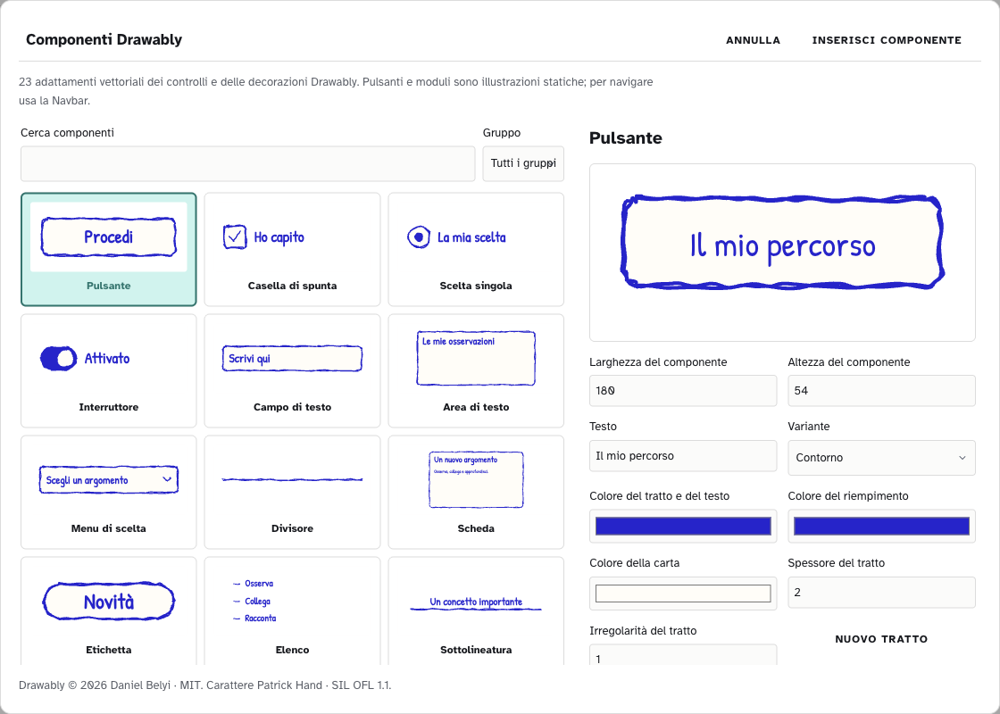

# Drawably in ZAINO: mappe e componenti per le slide

ZAINO include **23 elementi grafici adattati da Drawably** e un preset Drawably per Mappe e uno per Slide. Le risorse funzionano offline e il carattere Patrick Hand è incluso nell’app.

## Scegli lo stile

Apri **Impostazioni → TUNING** e cerca **Drawably**. Apri **… → Aspetto** sulla tessera della categoria che ti interessa, modifica la demo e premi **Salva stile**.

- **Mappe:** riquadri con il tratto disegnato a mano di Drawably, carta chiara e testo scuro. Il bordo di un nodo colorato usa il colore del nodo o del suo gruppo; i bordi neutri partono da gray-400. Il preset non aggiunge barre colorate. Puoi regolare **Angoli dei nodi**, **Spessore dei tratti** e **Dimensione delle frecce**. Nei nodi con immagine gli angoli superiori restano retti.
- **Slide:** fondo chiaro, testo scuro e titoli blu. Lo stile imposta l’aspetto di titoli e testi; per aggiungere le figure Drawably usa la libreria descritta sotto.

Per una prima prova puoi importare [Drawably · mappa](drawably-mappa.zaino-stile.json) oppure [Drawably · slide](drawably-slide.zaino-stile.json), inclusi nel kit. Ogni file descrive un solo tipo di stile. Per condividere una modifica fatta nell’app usa **… → Esporta** in TUNING.

La libreria raccoglie questi elementi:

| Gruppo | Elementi |
| --- | --- |
| Controlli | Pulsante, Casella di spunta, Scelta singola, Interruttore, Campo di testo, Area di testo, Menu di scelta, Divisore, Scheda, Etichetta, Elenco. |
| Decorazioni | Sottolineatura, Evidenziatore, Cerchio sul testo, Freccia. |
| Compositi | Chip, Schede di navigazione, Suggerimento, Avviso, Passaggi, Tasto, Citazione, Paginazione. |

## Crea una slide con un elemento Drawably

1. Apri una presentazione e scegli **Inserisci → Componenti Drawably…**.
2. Cerca un elemento in italiano o in inglese oppure filtra per gruppo: **Controlli**, **Decorazioni**, **Compositi**. Osserva l’anteprima.
3. Regola i campi disponibili per quel componente: testo, descrizione o autore, varianti, stato, colori del tratto e del testo, riempimento, carta, dimensioni, spessore e irregolarità. **Nuovo tratto** genera un’altra passata a mano. Le varianti dei pulsanti sono **Contorno**, **Pieno**, **Scarabocchio**.
4. Premi **Inserisci componente** e posizionalo nella slide con i normali controlli del foglio.
5. Seleziona l’oggetto e scegli **Modifica componente Drawably** per cambiarne le proprietà. Conferma con **Aggiorna componente**. Le modifiche partecipano ad **Annulla/Ripeti**.

Per esempio, scegli **Scheda**, scrivi **Le piante** nel campo Testo e **Osserva le foglie** in Descrizione, usa un fondo chiaro e un inchiostro scuro e premi Inserisci componente. Spostala o ridimensionala sulla slide, poi riapri Modifica componente Drawably per rifinire i testi. Applica lo stile Drawably ai titoli e ai testi della presentazione per coordinarne l’aspetto.

Gli elementi inseriti sono **illustrazioni vettoriali**. I controlli disegnati, come pulsanti o campi di un modulo, non sono moduli utilizzabili dal pubblico della presentazione. Le forme, i testi e le proprietà restano nel documento: puoi riaprire la presentazione e modificare ancora il componente. Per navigare tra le slide usa la Navbar di PRESENTA.

L’HTML offline contiene il risultato vettoriale, i caratteri locali e le licenze. Non richiede l’installazione di Drawably o l’accesso al suo sito. Per condividere una presentazione esportata, conserva l’intera cartella di esportazione.

## Usa immagini con un chatbot esterno

Per uno **stile mappa**, allega `stile.schema.json`, `drawably-mappa.zaino-stile.json` e l’immagine desiderata. Usa [PROMPT-MAPPA.txt](PROMPT-MAPPA.txt): i colori di parentela appartengono ai nodi della mappa, mentre il file imposta il neutro e l’aspetto generale. Controlla il risultato nella demo TUNING e salvalo.

Per una **navbar da un’immagine**, segui [l’esempio Taccuino blu](ESEMPIO-NAVBAR-DA-IMMAGINE.md). Una schermata Drawably può essere il riferimento visivo per colori e proporzioni; il JSON navbar sceglie una delle varianti di ZAINO. La libreria dei componenti Drawably inserisce illustrazioni nelle slide e non aggiunge una nuova variante interattiva di navbar.

## Licenza e contributi

Drawably è di **Daniel Belyi**, con [licenza MIT](https://github.com/danielwh2/drawably/blob/013c1a2dadf8d5b87c92698f18a60682711e4bfc/LICENSE). L’integrazione usa la versione **0.4.2**, revisione `013c1a2dadf8d5b87c92698f18a60682711e4bfc`, adattata al modello vettoriale di ZAINO. Il testo integrale è incluso nei crediti dell’app, nell’export HTML e in [LICENZA-DRAWABLY.txt](LICENZA-DRAWABLY.txt). Patrick Hand conserva la sua licenza SIL OFL 1.1.

Gli adattatori mantengono separate le risorse originali e il modello di ZAINO. Un contributo deve rispettare la validazione SVG, la persistenza, il funzionamento offline e le licenze. Per proporre nuove geometrie o interazioni di nodi e navbar, segui la sezione sviluppatori del [LEGGIMI](LEGGIMI.md).
