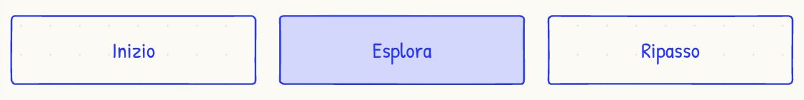
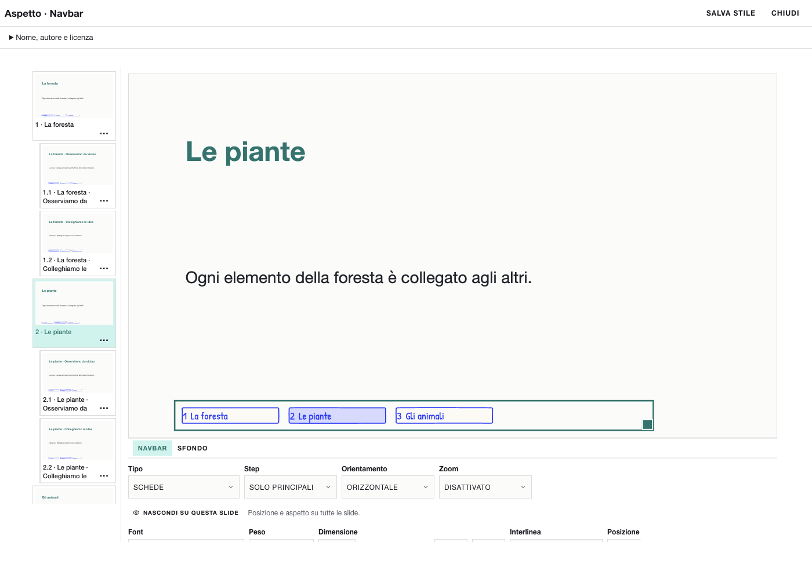

# Da un’immagine alla tua navbar: Taccuino blu

In questo esempio prepari un’immagine con tre riquadri, la alleghi a un chatbot insieme al kit e ottieni uno stile da importare in ZAINO. Il risultato desiderato è **Taccuino blu**: schede orizzontali, bordo blu e riempimento chiaro sul passo attivo.

**Il risultato usa il tratto Squig e il font Patrick Hand inclusi in ZAINO.** Il chatbot ricava colori, distanze e stato attivo dall’immagine; il file sceglie le risorse già presenti nell’app. Animazioni e codice esterno non vengono importati. L’immagine resta un riferimento, non diventa lo sfondo della navbar.

## 1. Prepara l’immagine in Squig o Drawably

**Percorso senza codice — Squig.** Apri [squig.sh](https://squig.sh/). Cerca **Button** con **⌘K** e disponi tre pulsanti in fila. Nel pannello delle proprietà scrivi le etichette **Inizio**, **Esplora**, **Ripasso**; scegli **outline** per il primo e il terzo, **filled** per il secondo. Il secondo rappresenta il passo attivo. Puoi usare la palette **Internet blue**, scegliere dimensioni uguali e lasciare uno spazio fra i riquadri. Squig è uno strumento per comporre bozzetti con componenti: il suo [progetto e README](https://github.com/pablostanley/squig) descrivono ricerca, varianti e salvataggio locale.

Cattura solo la striscia dei pulsanti, per esempio con **Maiusc–⌘–4** su Mac, e chiamala `mia-navbar.png`. Se vuoi partire dall’esempio già preparato, usa [taccuino-blu-riferimento.jpg](taccuino-blu-riferimento.jpg), creato in Squig per questa guida. Il [bozzetto modificabile](taccuino-blu.squig.json) si apre in Squig; è distinto dal file di stile destinato a ZAINO.



**Alternativa — Drawably.** [Drawably](https://github.com/danielwh2/drawably) è una libreria di componenti web, con varianti di pulsante come **outline**, **solid** e **scribble**. Se hai una pagina o un prototipo che la usa, cattura una navbar con un elemento attivo e uno inattivo e allega quella schermata. Per costruire il prototipo puoi usare un chatbot capace di eseguire codice, chiedendogli: «Prepara una demo con Drawably seguendo il README: tre pulsanti Inizio, Esplora, Ripasso; outline ai lati e solid al centro. Mostrami l’anteprima da catturare». Questo passaggio produce il riferimento visivo, mentre il passaggio successivo produce il JSON per ZAINO. Il codice della demo non si importa in TUNING.

Un link al repository da solo non mostra al chatbot quale risultato desideri: **allega sempre l’immagine concreta**. Se combini due immagini, precisa quale usare per i colori e quale per la disposizione.

## 2. Scarica il kit e allega i tre file

In ZAINO apri **Impostazioni → TUNING → Scarica kit chatbot…** e scompatta lo ZIP. Apri un chatbot esterno che accetti immagini e allega:

1. `stile.schema.json`: le regole del file importabile;
2. `sentiero.zaino-stile.json`: un esempio della struttura corretta;
3. `mia-navbar.png`, oppure `taccuino-blu-riferimento.jpg`: il risultato visivo che desideri.

Il chatbot deve poter leggere il contenuto dei due JSON. Se il servizio non accetta questi allegati, incollali in due messaggi distinti, indicando il nome del file, e carica l’immagine. ZAINO non invia file al servizio: gli allegati li scegli tu.

## 3. Copia questo prompt

```text
Voglio uno stile personale per la navbar di ZAINO chiamato «Taccuino blu».
Ho allegato lo schema, l’esempio Sentiero e un’immagine con tre riquadri.
Il riquadro centrale «Esplora» mostra lo stato attivo; gli altri sono inattivi.

Ricava dall’immagine colori, spazi e gerarchia. Proponi schede orizzontali
(variant tabs, orientation horizontal), testo Patrick Hand da 20 px, bordi blu
da 2 px, distanza 12 px e activeZoom 1. Lo stato attivo deve avere uno
sfondo blu chiaro e testo blu leggibile; gli altri uno sfondo chiaro.

Prima descrivi quali dettagli puoi riprodurre e quali devi adattare.
Per il disegno a mano usa fontFamily patrick-hand e grafica.tratto squig.
Non inventare campi roughness, scribble, animation, HTML, CSS o SVG.
Usa Sentiero soltanto per la struttura; conserva autore ZAINO e licenza
GPL-3.0-or-later dell’esempio. Non attribuire il file agli autori dei due
strumenti di riferimento. Dopo il mio OK restituisci solo il JSON completo
con formato zaino-stile, versione 1 e tipo navbar, conforme allo schema.
Non inserire Inizio, Esplora, Ripasso né collegamenti nel JSON: i titoli e
la navigazione saranno quelli della mia presentazione.
```

Per esempio, una proposta coerente è: «Uso schede con bordo blu e fondo chiaro; il passo attivo ha un riempimento azzurro. Uso il tratto Squig e il carattere Patrick Hand inclusi in ZAINO». Se ti convince, rispondi: **«Va bene. Genera il file completo `taccuino-blu.zaino-stile.json`, senza commenti né blocchi Markdown»**.

## 4. Salva il risultato come JSON

Se il chatbot offre un file scaricabile, scaricalo. Altrimenti copia soltanto il testo da `{` a `}` in un editor di testo semplice, salva in **UTF-8** e usa il nome `taccuino-blu.zaino-stile.json`. In TextEdit su Mac scegli prima **Formato → Converti in formato solo testo**. Controlla che il nome non finisca con `.json.txt` e che il contenuto non sia RTF o HTML.

Nel kit trovi un [output di esempio già verificato](taccuino-blu.zaino-stile.json). È una proposta preparata per la guida: la risposta del tuo chatbot può essere diversa. Puoi importarlo subito per confrontare il risultato, oppure aprirlo e leggerne i valori.

## 5. Importa e rifinisci in TUNING

1. Apri **Impostazioni → TUNING → Importa stile…** e scegli il file `.zaino-stile.json`, non lo ZIP, l’immagine o il `.squig.json`.
2. Nella categoria **Navbar** compare la tessera **Taccuino blu**. L’importazione lo ha già aggiunto alla tua raccolta; una presentazione aperta mantiene il suo aspetto finché non applichi lo stile.
3. Apri **… → Aspetto** sulla tessera. La demo contiene tre argomenti principali con due approfondimenti ciascuno. Per confrontarla con i tre riquadri del bozzetto, scegli **Step → Solo principali**, poi seleziona la seconda slide principale nella scaletta. Questa scelta dei passi riguarda la demo o la presentazione, non il file di stile. Seleziona slide diverse per confrontare lo stato attivo e quello inattivo.
4. Controlla contrasto, etichette lunghe e ingombro. I titoli, i numeri dei passi e le dimensioni dei riquadri della demo possono differire dal bozzetto: lo stile non contiene i testi né la posizione della navbar.
5. Regola colori, font e distanze, poi premi **Salva stile** per conservare le modifiche e **Chiudi**.



## 6. Usalo in una presentazione e condividilo

Apri una tua presentazione in **PRESENTA**. Scegli **Inserisci → Navbar**, oppure seleziona quella esistente. Apri **Aspetto → Intera navbar → Stili della community…**, scegli **Taccuino blu** e premi **Applica stile**. Avvia **Presenta** e prova i passi: sono le slide della tua presentazione a fornire titoli e destinazioni.

Per condividere la versione rifinita, torna in **TUNING**, apri **… → Esporta** sulla tessera e salva il nuovo `.zaino-stile.json`. Conserva l’attribuzione dell’esempio. Lo stile applicato viaggia con la presentazione; il JSON esportato serve ad aggiungerlo alla raccolta di un’altra persona.

## Se qualcosa non corrisponde

- **Importazione rifiutata:** copia il messaggio esatto e il JSON nel chatbot: «Correggi il file secondo lo schema allegato, mantenendo l’aspetto dove possibile. Restituisci il JSON completo». Salva il file corretto e importalo di nuovo.
- **Il bordo resta regolare:** verifica che il file contenga `grafica.tratto: "squig"`, che la variante sia `tabs` o `steps`, e che la copia di ZAINO includa gli stili Squig. Il tratto è volutamente leggero, come nell’originale. Non aggiungere proprietà sconosciute.
- **L’importazione riesce ma vuoi un’altra resa:** allega al chatbot la schermata di TUNING insieme al JSON e chiedi una modifica precisa, per esempio «rendi più scuro il testo attivo mantenendo i riquadri». Dopo la nuova importazione, riapplica lo stile alla presentazione.

Riferimenti verificati l’8 novembre 2026: [Drawably](https://github.com/danielwh2/drawably), [Squig](https://github.com/pablostanley/squig). Il bozzetto è stato creato per questa guida; il file ZAINO è una variante dell’esempio del kit. Il catalogo, le palette e il tratto di Squig sono integrati in ZAINO con licenza MIT; Drawably resta un riferimento esterno. Vedi [Squig in ZAINO](SQUIG-IN-ZAINO.md) per stili e componenti.
