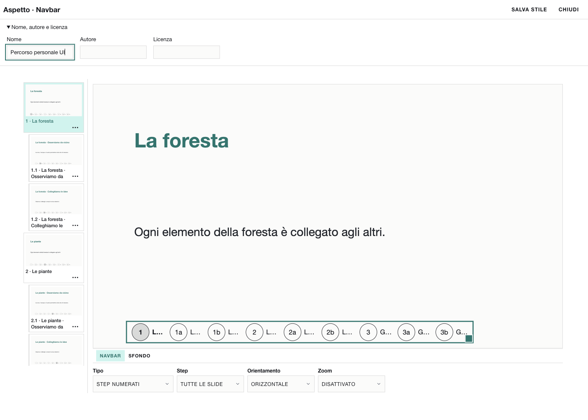
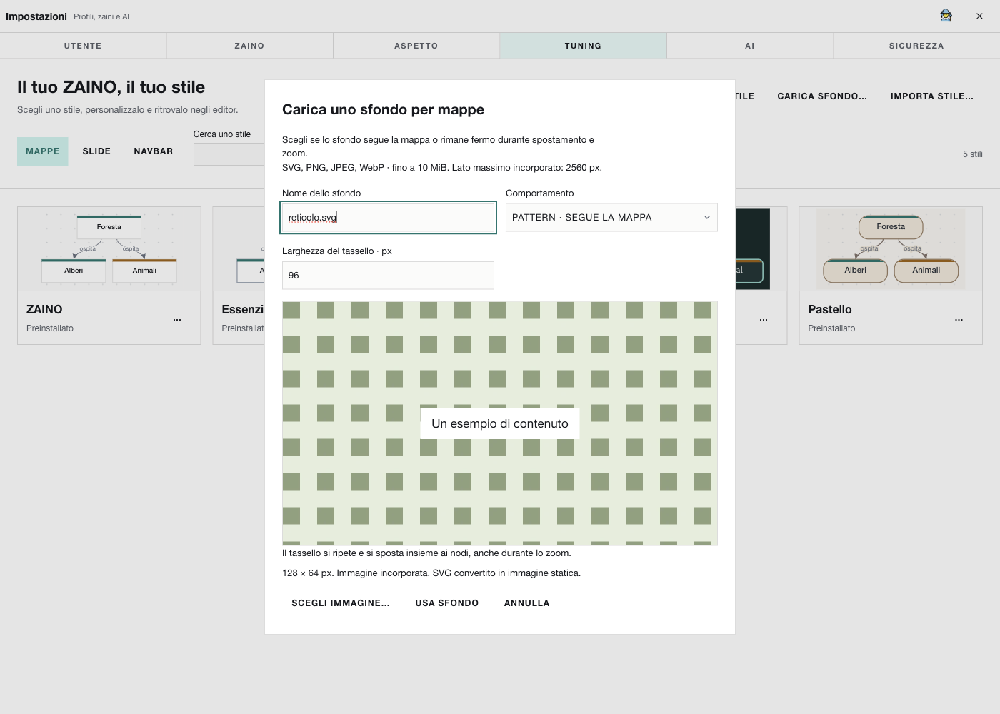
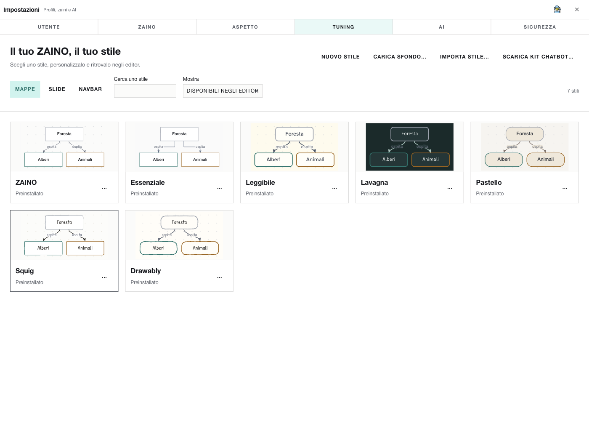
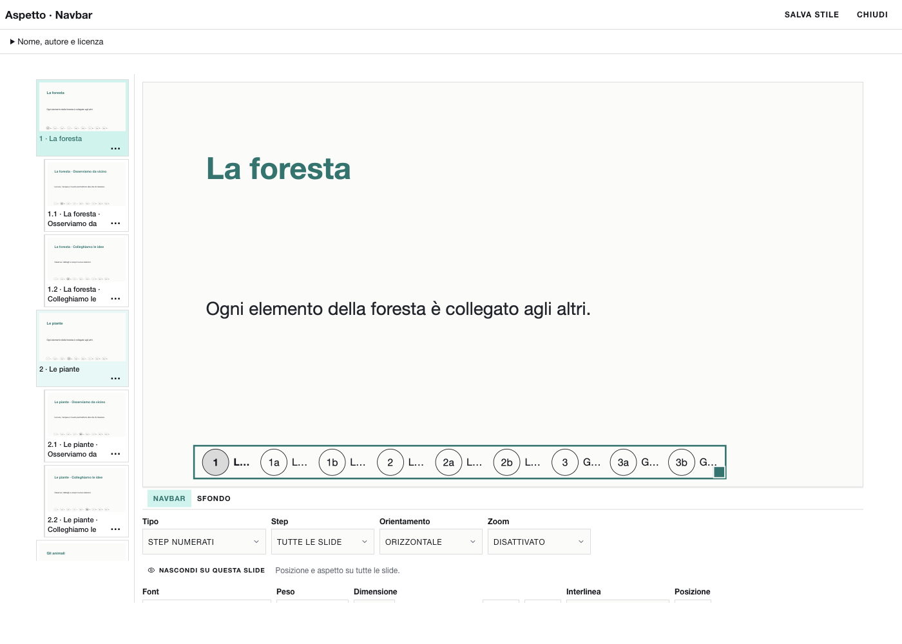
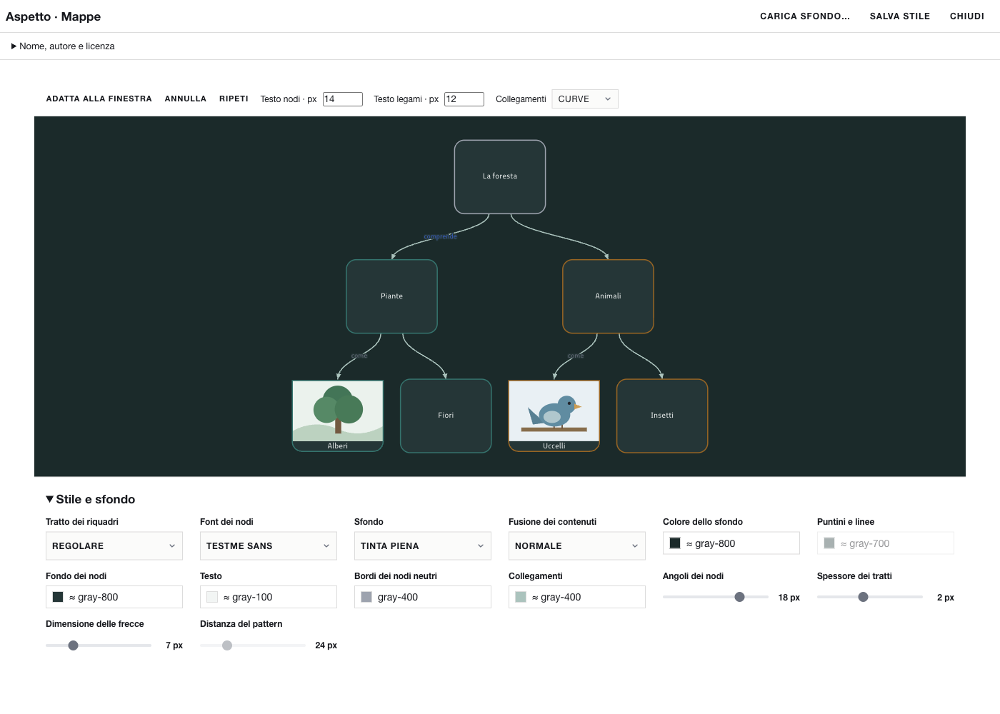
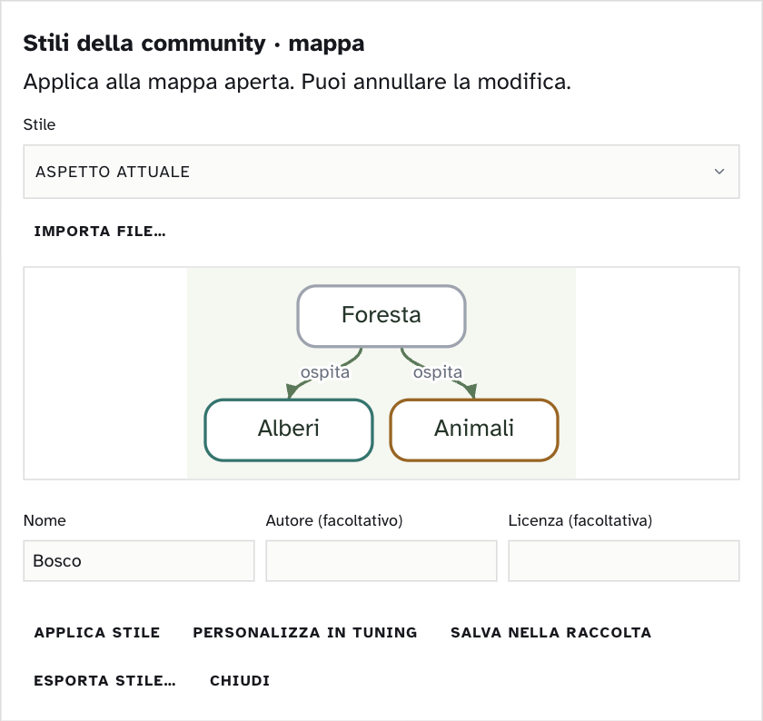
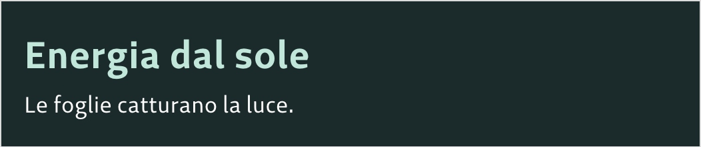
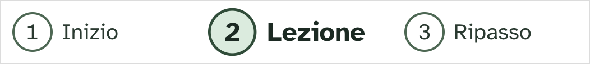

# Crea uno stile per ZAINO

Uno stile veste una mappa, le slide o la barra di navigazione di PRESENTA. Puoi prepararlo con i controlli di ZAINO, con un editor di testo o con un assistente AI. ZAINO legge il file sul computer e mostra un campione prima di cambiare il documento.

Usa una copia di ZAINO che mostri **Impostazioni → TUNING**. La galleria occupa l’intera finestra dell’app e funziona anche senza una mappa o una presentazione aperta. Le sezioni **Mappe**, **Slide** e **Navbar** raccolgono gli stili iniziali, quelli personali e quelli importati.

## Crea una navbar senza aprire una presentazione

1. Apri **Impostazioni → TUNING → Navbar → Nuovo stile**.
2. Dai un nome, per esempio **Percorso bosco**. La demo contiene tre argomenti, ciascuno con due approfondimenti: non serve una presentazione personale.
3. Scegli la variante **Schede** (`tabs`), font Atkinson, testo scuro e uno sfondo attivo verde chiaro. Prova i passi della demo e regola bordi, spaziature e ingrandimento attivo.
4. Premi **Salva stile** e **Chiudi**. Lo stile compare nella raccolta. Se chiudi prima di salvare puoi scartare la bozza: non rimane una tessera vuota.
5. In una nuova presentazione inserisci la Navbar, apri **Aspetto → Intera navbar → Stili della community…** e applica **Percorso bosco**. Per distribuirlo scegli **… → Esporta** in TUNING.

**Nuovo stile** è disponibile anche per Mappe e Slide. Parte da una base inclusa nell’app e crea una variante indipendente: i preset esistenti restano disponibili.



## Usa immagini con un chatbot esterno

Scarica il kit da **Impostazioni → TUNING → Scarica kit chatbot…**, scegli dove salvare lo ZIP e scompattalo. Il pulsante è disponibile nelle tre categorie di stili e funziona anche senza connessione.

Apri [PROMPT-NAVBAR.txt](PROMPT-NAVBAR.txt): contiene la lista degli allegati, il prompt completo e il percorso per correggere eventuali errori. Allega a un chatbot multimodale **schema + Sentiero + immagini di riferimento**. Chiedi prima una proposta, poi il JSON definitivo. Salvalo in UTF-8 e importalo in TUNING.

Per le mappe trovi anche [PROMPT-MAPPA.txt](PROMPT-MAPPA.txt), che descrive bordi neutri e colori di parentela.

Il chatbot può ricavare colori, proporzioni e gerarchia visiva dalle immagini. Può usare solo le proprietà ammesse: una forma nuova richiede un’estensione del programma, come spiegato nella sezione per sviluppatori. ZAINO non invia le immagini al chatbot; sei tu a scegliere il servizio e gli allegati.

**Prova il percorso completo:** [Da un’immagine alla tua navbar: Taccuino blu](ESEMPIO-NAVBAR-DA-IMMAGINE.md), con riferimento creato in Squig, alternativa Drawably, prompt e [JSON verificato da importare](taccuino-blu.zaino-stile.json).

## Stili e componenti Squig

La galleria TUNING contiene **un solo preset Squig per categoria**: mappa neutra color grafite, slide e navbar con il blu originale. Le **sei palette** appartengono invece alla libreria dei **155 componenti vettoriali** per le slide. Puoi usarle liberamente per un componente o creare una copia personale di uno stile. Leggi [Squig in ZAINO](SQUIG-IN-ZAINO.md) per scelta, modifica, esportazione e licenze.

Trovi anche **Drawably** nelle categorie Mappe e Slide. Per inserire i suoi elementi grafici scegli **PRESENTA → Inserisci → Componenti Drawably…**. Leggi [Drawably in ZAINO](DRAWABLY-IN-ZAINO.md), con esempi di stile già pronti per [mappe](drawably-mappa.zaino-stile.json) e [slide](drawably-slide.zaino-stile.json).

## Colori e tratti delle mappe

Il **bordo del nodo** indica il colore assegnato al nodo o al suo gruppo di parentela. Le vecchie barre colorate sono sostituite dai bordi. Un nodo senza colore usa **Bordi dei nodi neutri** nello stile: mappe e stili precedenti partono da **gray-400 (`#9ca3af`)**. Cambiare lo stile non cancella i colori che hai assegnato ai nodi. Scegliere Senza bordo per i neutri mantiene visibili i bordi dei nodi colorati e la selezione.

In **Stile e sfondo** puoi scegliere il tratto **Regolare**, **Squig · a mano** o **Drawably · a mano**. **Angoli dei nodi** regola il raggio; nei nodi con immagine gli angoli superiori restano retti e quelli inferiori seguono il valore scelto. **Spessore dei tratti** cambia anche la resa delle punte; **Dimensione delle frecce** permette di regolarle separatamente. Queste opzioni sono disponibili sia nella demo TUNING sia nella mappa.

**Fusione dei contenuti → Moltiplica (Multiply)** fonde nodi, immagini, testi e collegamenti con lo sfondo. Per osservarne l’effetto usa uno sfondo con texture o una tinta e un’immagine con zone bianche. Dopo aver modificato una demo, premi **Salva stile** per conservarne l’aspetto.

## Carica uno sfondo

In **TUNING → Mappe** o **Slide**, scegli **Carica sfondo…**. Seleziona un file **SVG, PNG, JPEG o WebP** entro **10 MiB**, controlla l’anteprima e premi **Usa sfondo**. Si apre una nuova bozza di stile: assegna il nome e premi **Salva stile**. Nella finestra **Aspetto** di uno stile esistente trovi lo stesso pulsante per sostituire lo sfondo conservando gli altri dettagli.

- **Slide:** il frame standard è **1280 × 720, rapporto 16:9**. Per esempio, un’immagine **1920 × 1080** riempie il frame senza deformazioni. **Riempi** conserva le proporzioni e taglia i bordi quando il rapporto è diverso; **Immagine intera** conserva tutto e può lasciare margini. Per presentazioni con misure diverse usa il loro rapporto larghezza/altezza.
- **Mappe, Pattern:** il tassello si ripete e si muove insieme ai nodi durante spostamento e zoom. Regola la larghezza del tassello; l’altezza mantiene il rapporto originale. È adatto a reticoli e texture ripetibili.
- **Mappe, Immagine fissa:** lo sfondo resta fermo mentre i nodi si spostano. È adatto a carta, illustrazioni e fondali. Puoi scegliere Riempi o Immagine intera.

La scelta Pattern/Immagine fissa è esplicita: il programma non la deduce dal contenuto del file. Un PNG può essere un tassello; uno SVG può essere un fondale. Per rimuovere uno sfondo da una mappa scegli una tinta o un altro sfondo nell’editor; per le slide scegli un altro sfondo nell’editor della demo e salva lo stile.

Le immagini vengono incorporate nello stile e nel documento: non dipendono dal file originale. Il lato maggiore viene limitato a **2560 px**, mantenendo le proporzioni; l’immagine incorporata non può superare **2 MiB**. Gli SVG vengono convertiti in immagini statiche: non conservano i vettori e non possono contenere script, animazioni o risorse esterne. Converti i testi SVG in tracciati per evitare sostituzioni di font. I file raster possono contenere fino a 36 megapixel.

Uno stile con sfondo personale richiede una versione di ZAINO che mostri **Carica sfondo…**; le versioni precedenti possono rifiutare questi campi anche se il formato resta versione 1. Per chi deve solo presentare, l’esportazione HTML offline include anche lo sfondo.



## Dalla piattaforma al tuo stile

1. Scarica un file `.zaino-stile.json` dalla piattaforma della community. Per la prima prova puoi usare [Bosco](bosco.zaino-stile.json), incluso in questo kit. Se hai scaricato uno ZIP, scompattalo prima.
2. Apri **Impostazioni → TUNING → Importa stile…**. ZAINO riconosce il tipo, verifica il formato e aggiunge il file alla galleria.
3. Apri **… → Aspetto** sulla tessera. Per slide e navbar compare l’editor PRESENTA con **3 slide principali e 2 approfondimenti ciascuna**. Per le mappe compare l’editor MAPPE con **7 nodi, 2 immagini e 6 collegamenti, di cui 3 con parole di collegamento**.
4. Usa i comandi sotto l’anteprima e seleziona gli elementi della demo per modificarne l’aspetto. La scaletta permette di controllare slide principali e approfondimenti. Per lo stile slide, il salvataggio ricava l’aspetto dalla slide selezionata. **Salva stile** conserva le modifiche nella raccolta; **Chiudi** chiede conferma per scartare quelle non salvate. Nome, autore e licenza sono nella sezione in alto.
5. Chiudi la finestra e applica lo stile nel tuo editor, come indicato nella tabella seguente. Gli stili applicati sono incorporati nei file di mappe e presentazioni: **viaggiano con lo zaino**, anche se chi lo apre non li ha importati nella propria raccolta. Le demo di TUNING non scrivono nei materiali personali.

Il menu **…** contiene **Aspetto**, **Esporta**, **Nascondi** (o **Mostra**, se lo stile è nascosto). Per gli stili **personali o importati** compare anche **Elimina**, con conferma. Gli stili **preinstallati** possono essere modificati e nascosti, ma non cancellati.

La ricerca filtra i nomi. Nascondere uno stile lo toglie dai selettori senza cancellarlo: lo ritrovi nel filtro **Nascosti** o **Tutti gli stili** e puoi mostrarlo di nuovo. Modificare o eliminare uno stile nella raccolta non cambia retroattivamente i materiali già creati.

La raccolta dei preset e le scelte di visibilità sono personali e locali al profilo di ZAINO. Gli stili salvati in precedenza nel pannello community e negli slot personali vengono recuperati. I preset eventualmente cancellati con una vecchia versione tornano **nascosti**. La distribuzione dalla piattaforma avviene tramite i file scaricati.







## Condividi una variante

Dopo averla modificata e salvata, chiudi l’editor e scegli **… → Esporta** sulla tessera in TUNING. Scegli dove scrivere il JSON: puoi caricarlo sulla piattaforma oppure passarlo a un’altra persona. L’esportazione serve a condividere il risultato del lavoro svolto nell’app. Comprende proprietà grafiche, nome, autore e licenza; non contiene lezioni o materiali personali.

Per recuperare l’aspetto di un documento, apri **Stili della community…** nell’editor, scegli **Aspetto attuale** e premi **Personalizza in TUNING**. ZAINO lo conserva nella raccolta e apre i controlli per modificarlo. Lo stesso comando apre direttamente uno stile già selezionato nella raccolta.

## Applica uno stile a un documento

| Esempio | Dove aprirlo | Cosa succede quando premi Applica stile |
| --- | --- | --- |
| [Bosco · mappa](bosco.zaino-stile.json) | **Le mie mappe → ingranaggio → Stile e sfondo**: scegli una tessera oppure **Stili della community…**. | Applica nodi, font, sfondo e collegamenti alla mappa aperta. Puoi annullare. |
| [Ardesia · slide](ardesia.zaino-stile.json) | **PRESENTA → Stile**. Scegli prima **Questa slide** o **Tutte le slide**, poi **Stili della community…**. | Titoli verde chiaro, testo bianco e fondo scuro. Il tema sostituisce il fondo con una tinta piena. Testi, riquadri, note e risorse restano nel documento. |
| [Sentiero · navbar](sentiero.zaino-stile.json) | In PRESENTA scegli **Inserisci → Navbar**, oppure seleziona la navbar esistente. Apri **Aspetto → Intera navbar → Stili della community…**. | Cambia la barra comune dell’intera presentazione. Si conservano posizione, visibilità e scelta dei passi. |

In PRESENTA puoi anche aprire un **slot personale** di Stile (il + o la matita) e scegliere **Stili della community…**. Qui **Applica stile** scrive nello slot indicato dal pannello; non cambia le slide. Per esportare uno slot, aprilo con la matita e usa **Esporta stile…** nel pannello community.

**Aspetto attuale**, per una slide, ricava il tema dal primo titolo e dal primo testo o elenco, dal carattere della presentazione e dal colore di fondo. Anche una slide vuota ricorda il tema importato per i titoli e i testi aggiunti in seguito. La base di un tema slide contiene un carattere e due misure (12–120 px); le misure di base oltre questi limiti vengono riportate all’intervallo. I dettagli opzionali possono conservare font e misure distinti per titolo e testo. I temi modificati in TUNING possono conservare anche aspetto e posizione di titolo e testo e le texture di carta incluse. Le immagini di sfondo caricate in TUNING fanno parte del file. Immagini e video inseriti come contenuti, e formattazioni per singola parola, non ne fanno parte. Per esportare esattamente un tema personale usa il suo slot o la raccolta.

Una presentazione salvata con un tema slide importato conserva anche la tipografia dei nuovi testi. Le copie di ZAINO precedenti a questa funzione possono rifiutare il nuovo campo: per chi deve soltanto presentare puoi esportare la lezione in HTML offline.

## I tre esempi nell’anteprima







## Modifica un esempio a mano

Duplica il file dell’esempio e aprilo con un editor di testo. Lascia invariati `"formato": "zaino-stile"` e `"versione": 1`. Cambia il nome e i valori dentro `stile`, salva come testo UTF-8 con estensione `.zaino-stile.json`. Un file descrive **un solo tipo**: `mappa`, `slide` o `navbar`. Per una collezione coordinata, condividi tre file.

Il nome è obbligatorio (1–40 caratteri). Autore e licenza sono facoltativi (1–80 caratteri ciascuno): scrivi lo pseudonimo che vuoi condividere e la licenza prevista per il tuo lavoro. Se rielabori uno stile altrui, conserva l’attribuzione richiesta. Il numero di versione identifica il formato del file.

| Tipo | Proprietà di stile |
| --- | --- |
| Mappa | `font`; `sfondo`: pieno, punti, linee, carta-cotone, carta-naturale, carta-chiara, personale. Per personale, includi `sfondoPersonale`. `carta`, `segno`, `nodo`, `testo`, `bordo`, `legame`: colori; `bordo` è il colore dei nodi neutri. `nodo` e `bordo` accettano anche `none`; per `bordo`, riguarda soltanto i neutri. `tratto`: regolare, squig, drawably. Includi `bordiColorati: 1` per la nuova regola dei bordi. `passo` 12–64, `raggio` 0–24, `spessore` 0.5–4, `freccia` 3–20 (misura base delle punte, 7 iniziale), `fsNodo` 9–20, `fsRel` 8–18 (pixel). `linee`: curva, dritto, orto. `fusione`: normal, multiply. Basta una proprietà: le altre tornano ai valori iniziali. |
| Slide | Sono obbligatori `font`, `sfondo`, `colore` (testo), `accento` (titolo), `titolo` e `testo` (dimensioni in px). Sono facoltativi `stileTitolo`, `stileTesto` (aspetto e riquadro, definiti nello schema) e `carta` (cotone, naturale, chiara) oppure `sfondoPersonale` (immagine incorporata). Ad esempio cambia `"titolo": 58` in `"titolo": 64`. |
| Navbar | `variant`: steps, tabs, progress. `orientation`: horizontal, vertical. `activeZoom`: 1, 1.1, 1.2, 1.3. `fontFamily`, `fontSize` (12–160 px), `color` e gli attributi tipografici elencati nello schema. In `grafica`: `markerSize` 12–80, `gap` 0–32, `border`, `line`, `separator`, `background`, `activeBackground`, `activeGraphicColor`, `activeTextColor`, `activeBorderOpacity`, `activeLineOpacity`. Le parti grafiche accettano colore e opacità; per i tratti anche `width` (0–16 px), per i separatori `enabled` (true/false). Le opacità vanno da 0 a 1. Le proprietà omesse usano i valori iniziali. |

I colori espliciti sono stringhe esadecimali a sei cifre, per esempio `"#173E35"`. I caratteri disponibili sono `zaino`, `arial`, `verdana`, `georgia`, `courier`, `atkinson`, `atkinson-next`, `testme`, `testme-alt`, `patrick-hand`. Usa le risorse incluse: niente CSS, JavaScript, HTML, URL o font esterni. Mappe e slide possono includere lo sfondo raster nel campo `sfondoPersonale`; usa il caricamento in TUNING per generarlo correttamente.

Lo [schema completo](stile.schema.json) è la definizione usata dall’app. Descrive anche i valori automatici e tutte le proprietà della navbar. Se il file viene rifiutato, controlla il tipo di pannello, il campo indicato e i valori ammessi. Il limite del file è **3 MiB**. In JSON non si usano commenti, virgole finali o unità come "16px".

## Tre prompt pronti da copiare

Allega all’assistente **lo schema e il file di esempio indicato**. Non servono mappe personali né slide della classe. Copia la risposta in un file JSON e importalo in **TUNING** per vedere il risultato e rifinirlo con i controlli grafici.

**Mappa — allega Bosco**

> Parti da bosco.zaino-stile.json e rispetta stile.schema.json. Crea una variante chiamata Carta e inchiostro: carta chiara, nodi chiari, testo scuro, bordi dei nodi neutri gray-400, collegamenti a squadra e font Atkinson. Usa bordiColorati: 1 e lascia i colori dei singoli nodi alla mappa. Mantieni leggibili le etichette dei legami. Conserva l’attribuzione dell’esempio. Restituisci soltanto un oggetto JSON valido, tipo mappa, versione 1, senza blocchi Markdown.

**Slide — allega Ardesia**

> Parti da ardesia.zaino-stile.json e rispetta stile.schema.json. Crea un tema slide chiamato Aula luminosa, per una lezione proiettata: sfondo chiaro, testo molto scuro, titoli color prugna, font TestMe, titolo 64 px e testo 40 px. Conserva l’attribuzione dell’esempio. Restituisci soltanto il JSON completo in versione 1, senza commenti, immagini o Markdown.

**Navbar — allega Sentiero**

> Parti da sentiero.zaino-stile.json e rispetta stile.schema.json. Crea una navbar chiamata Tappe: schede orizzontali, separatori sottili, passo attivo ingrandito di 1.2. Scegli un colore del testo attivo leggibile sul suo sfondo. Conserva l’attribuzione dell’esempio. Restituisci soltanto il JSON completo di tipo navbar, versione 1. Non aggiungere destinazioni o codice.

Prima di condividere, reimporta il file esportato in TUNING e applicalo a un documento di prova. Controlla testi e contrasti su una mappa fitta, una slide proiettata o una navbar con più passi, compreso quello attivo.

## Nuove forme e navbar: indicazioni per sviluppatori

Il JSON attuale è un **contratto di stile**, non un sistema di plugin. Le navbar disponibili sono `steps`, `tabs`, `progress`. I nodi delle mappe hanno riquadri rettangolari con raggio configurabile e tratto regolare, Squig o Drawably. Il formato non accetta HTML, CSS o JavaScript e non prevede tracciati arbitrari per queste forme.

**Si può scrivere una navbar in HTML?** Sì, come prototipo o come contributo al codice di ZAINO. Il renderer delle presentazioni genera già HTML/CSS. Non si può però importare una pagina HTML in TUNING come nuova navbar: il file importabile è `.zaino-stile.json`. Anche un SVG caricato come sfondo resta uno sfondo, non diventa la sagoma interattiva di un nodo o di un pulsante.

Per proporre una nuova tipologia:

1. Disegna una prova SVG con `viewBox`, proporzioni, stati normale/attivo e area interna per testo e numeri. Preferisci una geometria parametrica quando basta (rombo, capsula, esagono), così si adatta alle etichette.
2. Definisci un contratto dichiarativo: identificatore e versione della forma, parametri ammessi, margini interni, contorno, punti di aggancio dei collegamenti e comportamento quando cambia la dimensione. Questo è un progetto di estensione, **non un campo già importabile**. Evita codice eseguibile nei pacchetti della community.
3. Mantieni testi, focus, etichette accessibili e azioni gestiti dall’app. Per i nodi verifica anche selezione, immagini interne, ritaglio e collegamenti; per la navbar verifica click, tastiera, passo attivo e approfondimenti.
4. Implementa lo stesso contratto in anteprima, editor ed esportazione. Prova temi chiaro/scuro, testi lunghi, due orientamenti, zoom, riapertura, HTML offline e PDF. Aggiungi casi validi e invalidi alla validazione.

Lo SVG `viewBox` descrive il sistema di coordinate; `preserveAspectRatio` controlla proporzioni e adattamento ([MDN](https://developer.mozilla.org/en-US/docs/Web/SVG/Reference/Attribute/preserveAspectRatio)). Per limitare immagini o riempimenti al contorno si può usare `clipPath`, senza confondere il ritaglio visivo con la gestione delle interazioni ([MDN](https://developer.mozilla.org/en-US/docs/Web/SVG/Reference/Element/clipPath)).

Nel repository, i punti di ingresso sono:

| Area | File e responsabilità |
| --- | --- |
| Formato condiviso | `App/guida-zaino/download/stili/stile.schema.json`, `lib/stili-community.js`: proprietà accettate, limiti e verifiche. |
| Navbar | `App/assets/presentazioni/modello.js`: varianti e operazioni; `reveal-adapter.js`: markup; `deck.css`: resa; `App/assets/presentazioni/navigazione.js`, `App/presentazioni-player/frame.js`, `App/assets/presentazioni/player.js`: comportamento e player. |
| Mappe | `App/assets/mappa/aspetto.js`: stile; `disegna.js`: SVG; `layouts.js`: geometria e disposizione. |
| Editor e campioni | `App/assets/presentazioni/editor.js`, `App/assets/mappa/aspetto-ui.js`, `App/assets/interfaccia/stili-ui.js`, `tuning-ambiente.js`. |
| Prove | `test/stili-community.js`, `test/tuning-sfondi.js`, prove del modello presentazioni e SVG mappe; `test/cdp/prova-tuning-sfondi.js` verifica i comandi reali. |

Un contributo utile include esempio JSON valido, screenshot chiaro/scuro, eventuale SVG di riferimento, descrizione degli stati, licenza e attribuzioni, versione minima di ZAINO, limiti conosciuti e prove. La community può condividere subito **varianti di stile** con il kit; **nuove geometrie o interazioni** richiedono una modifica del programma prima di poterle distribuire come dati.

Chi ha il repository può verificare un file senza avviare l’app:

```sh
node bin/verifica-stile.js /percorso/percorso-bosco.zaino-stile.json
```

La validazione controlla il contratto; l’anteprima serve comunque a giudicare leggibilità e resa.
