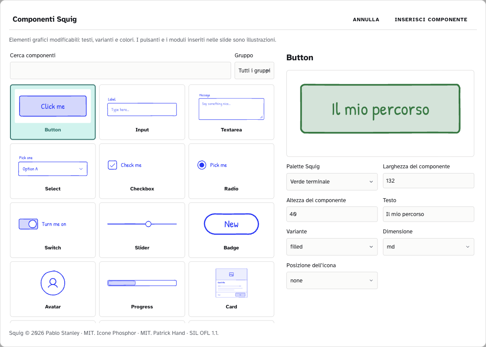

# Squig in ZAINO: stili e componenti

ZAINO include **155 componenti di Squig**, disponibili senza connessione. La loro libreria offre **sei palette**: Blu Internet, Rosso riso, Verde terminale, Prugna, Ocra e Grafite. Il carattere Patrick Hand è incluso nell’app. In TUNING trovi invece **un solo preset Squig per categoria**: Mappe, Slide e Navbar.

## Scegli uno stile coordinato

Apri **Impostazioni → TUNING** e cerca **Squig**. Trovi una tessera Squig in Mappe, una in Slide e una in Navbar. Apri **… → Aspetto**, prova la demo e salva una variante personale con il nome che preferisci.

- **Mappe:** palette neutra color grafite, Patrick Hand e contorni disegnati a mano. Il preset non usa toni blu: il colore del bordo serve a distinguere le parentele dei nodi. Un nodo senza colore usa il neutro dello stile, inizialmente gray-400. Nel pannello Aspetto puoi scegliere **Tratto dei riquadri → Squig · a mano** anche per uno stile personale. Nei nodi con immagine gli angoli superiori restano retti; il raggio si applica a quelli inferiori.
- **Slide:** sfondo chiaro e tipografia con il blu originale di Squig. Applica lo stile da **Stili e layout → Stili della community…** in PRESENTA. Per aggiungere riquadri, schede e altre figure Squig usa la libreria descritta sotto.
- **Navbar:** schede con contorni e testo blu Squig, passo attivo riempito. Applica lo stile da **Aspetto → Intera navbar → Stili della community…**. Il tratto Squig è disponibile per Schede e Step numerati; la Linea di avanzamento conserva il tratto regolare. Titoli e destinazioni continuano a provenire dalla presentazione.

Le vecchie varianti preinstallate che differivano soltanto per colore vengono riunite in queste tre tessere. Se avevi modificato un vecchio preset, ZAINO ne conserva una copia personale; le copie già personali e gli stili importati rimangono. La visibilità del preset conservato viene rispettata. Puoi creare una variante personale con altri colori oppure modificarli nella singola presentazione. Applicare uno stile crea una copia nel documento: modificarlo successivamente in TUNING non cambia i documenti esistenti.

## Inserisci e modifica un componente

1. Apri una presentazione e scegli **Inserisci → Componenti Squig…**.
2. Cerca un elemento, per esempio **pulsante** o **button**, **scheda** o **card**, oppure filtra per gruppo. I nomi dei componenti e delle varianti conservano quelli del catalogo originale. Le pagine mostrano 24 elementi alla volta.
3. Seleziona un elemento. A destra modifica palette, larghezza, altezza, testi e le opzioni disponibili: varianti, icone, quantità o stato. L’anteprima si aggiorna prima dell’inserimento.
4. Premi **Inserisci componente**. Spostalo e ridimensionalo con i normali controlli del foglio. Il disegno conserva le proporzioni; per cambiare la forma del componente usa Larghezza e Altezza nella sua finestra.
5. Seleziona l’oggetto e scegli **Modifica componente Squig**. Premi **Aggiorna componente** per confermare. **Annulla/Ripeti** funziona anche per queste modifiche.

I componenti sono **illustrazioni vettoriali**: un pulsante disegnato non apre un link e un campo di un modulo non raccoglie dati. Per navigare fra le slide usa la Navbar di PRESENTA. Le icone si scelgono con il nome Phosphor, per esempio `arrow-right`, `star` o `user`.

Testi, proprietà e vettori vengono salvati nella presentazione. Alla riapertura puoi modificarli ancora. L’HTML offline contiene i vettori, il font locale e le licenze; chi guarda la presentazione non deve installare Squig né accedere a un servizio online. Le stampe usano il disegno della slide o della mappa. Le versioni precedenti di ZAINO possono rifiutare i nuovi campi: per la sola visione usa l’esportazione HTML.

## Usa il kit con un chatbot

Segui [l’esempio Taccuino blu da un’immagine](ESEMPIO-NAVBAR-DA-IMMAGINE.md). Per la navbar il JSON può indicare `fontFamily: "patrick-hand"` e `grafica.tratto: "squig"`; per le mappe usa `font: "patrick-hand"` e `tratto: "squig"`. Il file descrive lo stile. Il bozzetto `.squig.json` si apre in Squig; i componenti nelle slide si inseriscono dalla libreria di ZAINO.

## Licenze e contributi della community

Squig è di **Pablo Stanley**, con [licenza MIT](https://github.com/pablostanley/squig/blob/dd42610b2030b5547e0ce94d5771f45c246792ec/LICENSE). L’app riusa il catalogo e le primitive del commit `dd42610b2030b5547e0ce94d5771f45c246792ec`, adattati al modello di ZAINO. Le icone Phosphor sono MIT; Patrick Hand di Patrick Wagesreiter usa SIL OFL 1.1. Testi integrali e attribuzioni sono nei crediti dell’app e accompagnano l’export HTML. Il kit contiene anche la licenza Squig per il riferimento visivo.

Per contribuire al codice, il sorgente originale è in `vendor/squig/`, con revisione e impronte in `provenienza.json`. Gli adattatori sono `lib/squig-catalogo.ts` e `lib/squig-tratti.ts`. Dopo una modifica esegui `npm run squig:build`, `npm run squig:verifica` e `node test/squig.js`; il test UI è `test/cdp/prova-squig.js`. Il catalogo viene caricato quando apri la libreria. L’albero SVG salvato resta leggibile senza eseguire codice del file importato.

Per introdurre forme o interazioni nuove nel contratto di navbar e nodi, segui la sezione sviluppatori del [LEGGIMI](LEGGIMI.md): aggiorna schema, validazione, rendering, controlli e prove. Un prototipo HTML è utile per discutere il risultato; non è un file importabile in TUNING.
